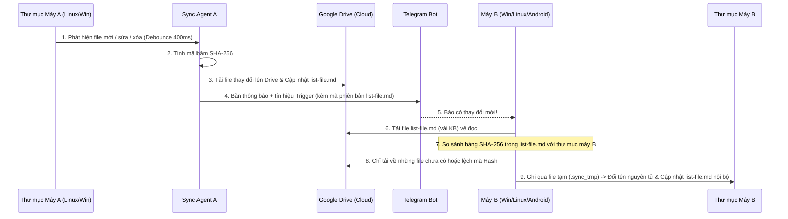

# Kế Hoạch Triển Khai Ứng Dụng Đồng Bộ Thư Mục Đa Nền Tảng (Kiến Trúc `list-file.md` + Google Auth)

## 1. Tổng Quan Kiến Trúc Đã Tối Ưu Hóa

Nhờ ý tưởng sử dụng **Đăng nhập Google** kết hợp với file chỉ mục **`list-file.md`** và **Telegram Trigger**, hệ thống loại bỏ hoàn toàn việc phải cấu hình hạ tầng mạng phức tạp (không cần mở port, không cần IP tĩnh, không cần chung mạng LAN hay dựng Server riêng).

| Hạng mục | Giải pháp thiết kế |
| :--- | :--- |
| **Xác thực (Auth)** | **Đăng nhập bằng Google (OAuth2)**: Các thiết bị (Android, Linux, Windows) chỉ cần đăng nhập cùng 1 tài khoản Google là tự động nhận diện và tin cậy nhau. |
| **Cơ chế kiểm tra đồng bộ** | **File chỉ mục `list-file.md`**: Chứa danh sách toàn bộ file trong vùng sync kèm mã băm `SHA-256`, dung lượng, thời gian sửa, trạng thái (`ACTIVE`/`DELETED`) và `driveFileId`. Tự động cập nhật mỗi khi thư mục có thay đổi. |
| **Nơi lưu & truyền file** | **Google Drive API**: Lưu trữ file `list-file.md` và các file dữ liệu trong một thư mục chuyên biệt trên Google Drive của chính tài khoản đó. Các máy chỉ cần đọc `list-file.md`, so sánh mã hash và tải về đúng những file chưa đồng bộ. |
| **Cơ chế Trigger & Thông báo** | **Telegram Bot**: Ngay khi 1 máy cập nhật `list-file.md` lên Drive, nó bắn tin nhắn qua Telegram Bot. Các máy PC khác bắt tín hiệu này để tự động kéo file về ngay lập tức; điện thoại Android nhận thông báo để người dùng biết và mở app đồng bộ bất kỳ lúc nào (không tốn pin chạy ngầm). |
| **Công nghệ (Tech Stack)** | **Node.js & TypeScript Monorepo (`pnpm`)**:<br>- **Linux & Windows**: Chạy Local Sync Agent siêu nhẹ kèm giao diện Web tại `http://localhost:8384`.<br>- **Android**: Đóng gói cùng giao diện **React + Tailwind CSS** bằng **Capacitor**. |
| **Đổi thư mục đồng bộ** | Hiển thị hộp thoại 2 lựa chọn khi đổi:<br>1. Chỉ trỏ sang thư mục mới và đồng bộ lại theo `list-file.md`.<br>2. Tự động copy toàn bộ dữ liệu từ thư mục cũ sang thư mục mới. |
| **Xử lý xung đột (Conflict)** | Giữ bản sửa mới nhất làm file chính + Đổi tên bản kia thành `<tên_file>.conflict-<tên_máy>` (An toàn tuyệt đối, không mất dữ liệu). |

---

## 2. Sơ Đồ Luồng Hoạt Động (`list-file.md` + Google Drive + Telegram)



---

## 3. Thiết Kế Cấu Trúc File `list-file.md`

File `list-file.md` được lưu cả ở thư mục đồng bộ nội bộ lẫn trên Google Drive. Định dạng của file vừa giúp **con người mở ra đọc hiểu ngay**, vừa giúp **máy phân tích tự động (parse) chính xác 100%**:

```markdown
# 📋 Danh Sách File Đồng Bộ (FolderSync Index)

- **Cập nhật lần cuối**: `2026-11-09T16:15:00.000Z`
- **Thiết bị cập nhật**: `Linux-PC`
- **Phiên bản chỉ mục (Revision)**: `14`

| Đường dẫn file (`Path`) | Mã băm (`SHA-256`) | Dung lượng (`Bytes`) | Thời gian sửa (`ModifiedAt`) | Trạng thái (`Status`) | Thiết bị (`UpdatedBy`) | Drive ID (`DriveFileId`) |
| :--- | :--- | ---: | :--- | :---: | :--- | :--- |
| `docs/ke-hoach.pdf` | `e3b0c44298fc1c149afbf4c8996fb924...` | 245120 | `2026-11-09T16:10:00.000Z` | `ACTIVE` | `Linux-PC` | `1A2b3C4d5E6f...` |
| `notes/todo.txt` | `8f434346648f6b96df89dda901c5176b...` | 1024 | `2026-11-09T16:14:55.000Z` | `ACTIVE` | `Android-Phone` | `9Z8y7X6w5V4u...` |
| `old/nhap.docx` | `-` | 0 | `2026-11-09T15:00:00.000Z` | `DELETED` | `Windows-PC` | `-` |
```

### Quy tắc đồng bộ dựa trên `list-file.md`:
1. **Khi thư mục trên máy có thay đổi**:
   - Quét file vừa thay đổi (bỏ qua chính sự kiện do quá trình tải đồng bộ tạo ra để chống lặp vô tận - `Anti-Loop`).
   - Tải file mới/sửa lên Google Drive để lấy `DriveFileId`.
   - Cập nhật dòng tương ứng trong `list-file.md` và đẩy `list-file.md` mới nhất lên Google Drive.
2. **Khi máy khác kiểm tra `list-file.md`**:
   - Đọc bảng trong `list-file.md` từ Google Drive và so sánh từng dòng với trạng thái thư mục hiện tại trên máy:
     - Nếu `Status == ACTIVE` và máy mình **chưa có file** hoặc **mã `SHA-256` khác**:
       - Kiểm tra xem file trên máy mình có bị sửa độc lập từ sau lần đồng bộ trước không:
         - Nếu **không**: Tải file mới từ `DriveFileId` về `.sync_tmp`, sau đó ghi đè vào vị trí đích.
         - Nếu **có (Xung đột / Conflict)**: Giữ bản có `ModifiedAt` mới hơn làm file chính, đổi tên bản cũ hơn thành `<tên_file>.conflict-<tên_máy>`.
     - Nếu `Status == DELETED` và file vẫn đang tồn tại trên máy mình (với cùng mã hash cũ):
       - Tự động xóa file đó trên máy mình để đồng bộ trạng thái xóa.

---

## 4. Cấu Trúc Thư Mục Dự Án Monorepo (`pnpm`)

```text
/home/quyhx/Downloads/tmp/91126/
├── docs/
│   ├── implementation_plan.md
│   └── task.md
├── package.json
├── pnpm-workspace.yaml
├── packages/
│   ├── shared/                       # Logic xử lý list-file.md & kiểu dữ liệu dùng chung
│   │   └── src/
│   │       ├── types.ts              # FileRecord, SyncConfig, SyncLogEntry, ConflictInfo
│   │       └── list-file-codec.ts    # Bộ đọc (parse) & tạo (serialize) file list-file.md
│   ├── desktop-agent/                # Node.js Sync Service cho Linux & Windows
│   │   └── src/
│   │       ├── index.ts              # HTTP/WS Server phục vụ Web UI tại localhost:8384
│   │       ├── config-manager.ts     # Quản lý cấu hình & đổi thư mục (2 chế độ)
│   │       ├── folder-watcher.ts     # Chokidar theo dõi thư mục + Debounce + Anti-Loop
│   │       ├── google-drive.ts       # Xác thực Google OAuth2 & Upload/Download file + list-file.md
│   │       ├── sync-coordinator.ts   # Đối chiếu list-file.md, tải file thiếu, xử lý .conflict
│   │       └── telegram-service.ts   # Bắn thông báo & nhận tín hiệu Trigger qua Telegram Bot
│   └── web-ui/                       # Giao diện React + Vite + Tailwind CSS + Capacitor (Android)
│       ├── capacitor.config.ts
│       └── src/
│           ├── App.tsx
│           ├── components/
│           │   ├── OnboardingView.tsx      # Đăng nhập Google + Chọn thư mục lần đầu
│           │   ├── FolderSwitchModal.tsx   # Chọn thư mục mới + 2 tùy chọn xử lý dữ liệu cũ
│           │   ├── ListFileViewer.tsx      # Hiển thị trực quan bảng list-file.md ngay trên UI
│           │   ├── TelegramSettings.tsx    # Cài đặt Bot Token, Chat ID & Nút Test
│           │   └── ActivityLogPanel.tsx    # Nhật ký đồng bộ thời gian thực
│           └── services/
│               └── api.ts
```

---

## 5. Kế Hoạch Kiểm Thử (Verification Plan)

1. **Unit & Integration Test tự động**:
   - Kiểm thử bộ đọc/ghi `list-file.md` (`list-file-codec.test.ts`): đảm bảo xuất bảng Markdown chuẩn và đọc ngược lại chính xác 100%.
   - Kiểm thử đồng bộ 2 chiều giữa 2 thư mục máy A và máy B thông qua kho lưu trữ trung gian:
     - Máy A thêm/sửa file -> `list-file.md` tự cập nhật -> Máy B đọc `list-file.md` và tự tải đúng file mới về.
     - Máy A xóa file -> `list-file.md` đánh dấu `DELETED` -> Máy B tự xóa file tương ứng.
     - Cả 2 máy cùng sửa 1 file -> Tự động sinh file `.conflict-<tên_máy>` không mất dữ liệu.
     - Đổi thư mục đồng bộ ở cả 2 chế độ (Chỉ đổi đường dẫn & Copy dữ liệu sang thư mục mới).
2. **Kiểm thử Build & Giao diện**:
   - Chạy `pnpm build` và `pnpm test` đảm bảo toàn bộ dự án hoạt động trơn tru.
