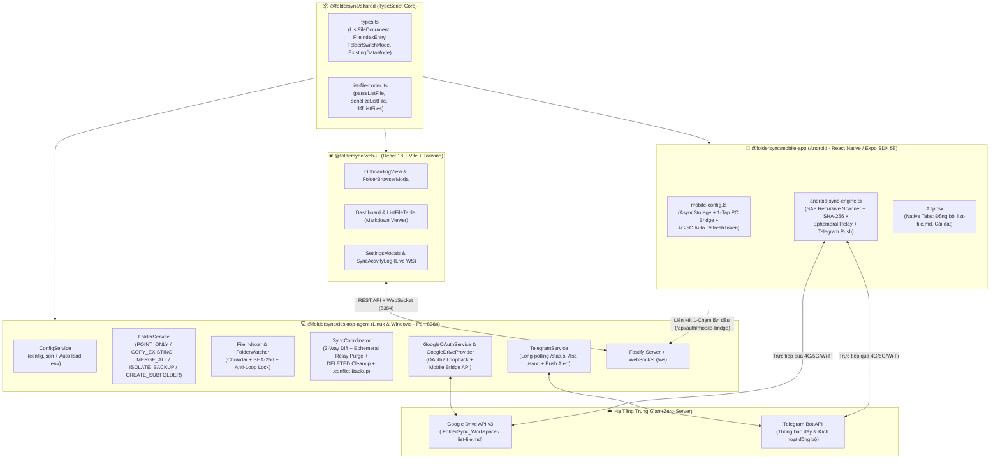
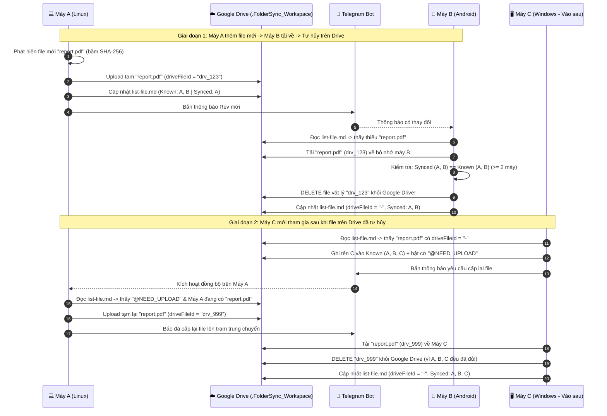
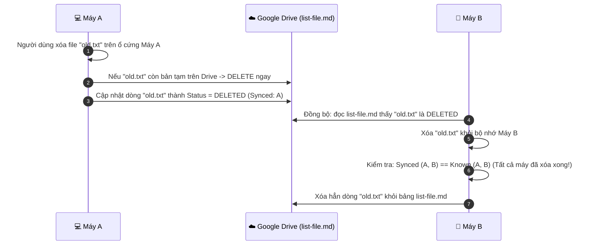
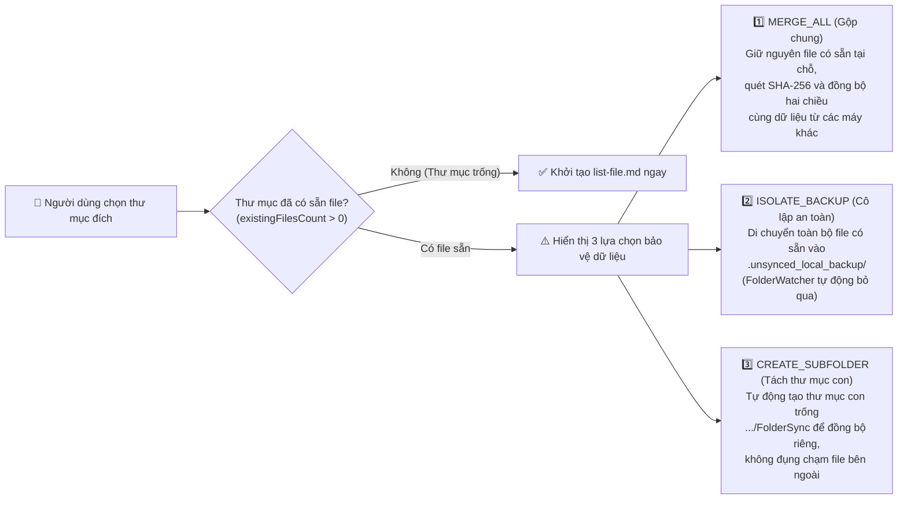
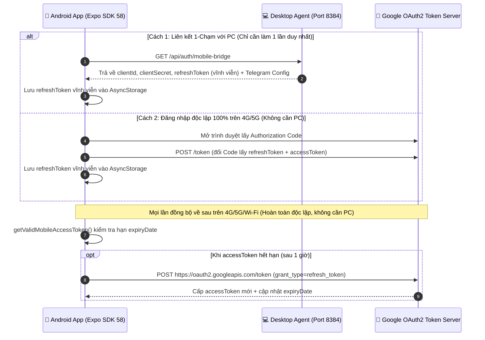

# 🏗️ Kiến Trúc Hệ Thống FolderSync (Android · Linux · Windows)

> **Cập nhật đến**: Giai đoạn 8 (Expo SDK 58 · Trạm Trung Chuyển Tự Hủy · Bảo Vệ Thư Mục Có Sẵn Dữ Liệu · Xác Thực 4G/5G Độc Lập)

Tài liệu này mô tả chi tiết kiến trúc tổng thể, cấu trúc bảng chỉ mục **`list-file.md`**, các luồng hoạt động cốt lõi và sơ đồ **Mermaid** của hệ thống **FolderSync**.

---

## 1. Triết Lý Thiết Kế Cốt Lõi

1. **Google Drive chỉ là "Trạm Trung Chuyển Tự Hủy" (Ephemeral Relay) — KHÔNG phải kho lưu trữ đám mây cố định**:
   - Dữ liệu thực sự thuộc về ổ cứng của các thiết bị (**Linux**, **Windows**, **Android**).
   - Google Drive chỉ giữ cố định duy nhất file chỉ mục văn bản **`list-file.md`** (vài KB).
   - Các file vật lý khi được đẩy lên `.FolderSync_Workspace` chỉ nằm tạm trên Google Drive để các máy khác tải về. **Ngay khi tất cả thiết bị đã biết trong mạng (`knownDevices`, tối thiểu $\ge 2$ máy) đều đã tải xong (`syncedDevices`), hệ thống tự động gọi lệnh xóa vĩnh viễn file vật lý đó trên Google Drive (`deleteRemoteFile`) và trả `driveFileId` về `'-'`**.
2. **Tự phục hồi khi có thiết bị mới tham gia (`@NEED_UPLOAD`)**:
   - Nếu một thiết bị thứ 3 tham gia vào mạng sau khi file vật lý trên Google Drive đã bị tự hủy (`driveFileId === '-'`), thiết bị mới sẽ bật cờ `@NEED_UPLOAD` (`requestUpload: true`) trên dòng file đó trong `list-file.md` và bắn thông báo Telegram.
   - Bất kỳ thiết bị cũ nào đang giữ bản file gốc trên ổ cứng sẽ tự động đẩy tạm file đó lên lại Google Drive để máy mới tải về, rồi lại tự hủy tiếp ngay sau khi máy mới nhận xong!
3. **Tự động dọn sạch dòng `DELETED` (Tombstone Garbage Collection)**:
   - Khi 1 máy xóa file, dòng đó trong `list-file.md` chuyển sang trạng thái `DELETED` để báo cho các máy khác xóa theo.
   - Ngay khi tất cả thiết bị trong `knownDevices` ($\ge 2$ máy) đều đã xác nhận xóa xong trên ổ cứng của mình, **dòng `DELETED` đó sẽ bị xóa hẳn khỏi `list-file.md`**, giúp file chỉ mục luôn gọn sạch.

---

## 2. Sơ Đồ Kiến Trúc Tổng Quan Monorepo



---

## 3. Cấu Trúc Bảng Chỉ Mục `list-file.md`

File `list-file.md` được lưu cả ở thư mục đồng bộ cục bộ của mỗi máy lẫn trên thư mục `.FolderSync_Workspace` của Google Drive:

```markdown
# FolderSync Index (list-file.md)

- **Last Updated**: 2026-11-10T10:00:00.000Z
- **Updated By**: Linux-PC
- **Revision**: 12
- **Known Devices**: Linux-PC, Windows-PC, Android-Phone

| Relative Path | SHA-256 | Size (Bytes) | Modified At (ISO) | Status | Updated By | Drive File ID | Synced Devices |
| :--- | :--- | ---: | :--- | :--- | :--- | :--- | :--- |
| `docs/spec.pdf` | `a1b2c3...` | 14200 | 2026-11-10T09:55:00.000Z | ACTIVE | Linux-PC | `-` | Linux-PC, Windows-PC, Android-Phone |
| `notes/todo.txt` | `f9e8d7...` | 512 | 2026-11-10T10:00:00.000Z | ACTIVE | Android-Phone | `1AbCdEfGhIjKlMnOp` | Android-Phone |
```

- **Khi `Drive File ID` là `1AbCdEfGhIjKlMnOp`**: File đang nằm tạm trên Google Drive vì mới chỉ có `Android-Phone` trong cột `Synced Devices`.
- **Khi `Drive File ID` là `'-'`**: Cả 3 thiết bị trong `Known Devices` đều đã tải xong (`Synced Devices: Linux-PC, Windows-PC, Android-Phone`), nên bản tạm trên Google Drive đã được **tự động xóa sạch**.
- **Khi cột `Synced Devices` có hậu tố `@NEED_UPLOAD`**: Một thiết bị mới vừa tham gia chưa có file này trên ổ cứng nên bật cờ yêu cầu một máy cũ đẩy tạm lại lên Google Drive.

---

## 4. Luồng Hoạt Động Chi Tiết (Mermaid Sequence Diagrams)

### 4.1. Luồng "Trạm Trung Chuyển Tự Hủy" (Ephemeral Relay) & Cấp Lại File (`@NEED_UPLOAD`)



---

### 4.2. Luồng Xóa File & Tự Động Dọn Sạch Dòng `DELETED` Khỏi `list-file.md`



---

### 4.3. Ba Chế Độ Bảo Vệ Khi Chọn Thư Mục Đã Có Sẵn Dữ Liệu

Khi người dùng chọn một thư mục đồng bộ (lần đầu hoặc khi đổi thư mục) mà bên trong đã có sẵn các file cá nhân (`existingFilesCount > 0`), hệ thống hiển thị cảnh báo và cung cấp 3 chiến lược xử lý an toàn trong [`FolderService`](file:///home/quyhx/Downloads/tmp/91126/packages/desktop-agent/src/services/folder-service.ts):



---

### 4.4. Luồng Xác Thực OAuth2 & Tự Gia Hạn `refreshToken` Độc Lập Trên 4G/5G (Android)

Để giải quyết triệt để lỗi `400: invalid_request` của Google OAuth đối với `exp://` trên Expo Go và đảm bảo điện thoại hoạt động độc lập 100% khi đi ra ngoài dùng mạng **4G/5G**:



---

## 5. Danh Mục Các Package & File Quan Trọng

| Package | File chính | Vai trò |
| :--- | :--- | :--- |
| **`@foldersync/shared`** | [`packages/shared/src/types.ts`](file:///home/quyhx/Downloads/tmp/91126/packages/shared/src/types.ts) | Định nghĩa toàn bộ kiểu dữ liệu dùng chung (`ListFileDocument`, `FileIndexEntry`, `ExistingDataMode`, `FolderSwitchMode`). |
| **`@foldersync/shared`** | [`packages/shared/src/list-file-codec.ts`](file:///home/quyhx/Downloads/tmp/91126/packages/shared/src/list-file-codec.ts) | Bộ giải mã/mã hóa bảng Markdown `list-file.md` và thuật toán so khớp 3 chiều `diffListFiles`. |
| **`@foldersync/desktop-agent`** | [`packages/desktop-agent/src/services/config-service.ts`](file:///home/quyhx/Downloads/tmp/91126/packages/desktop-agent/src/services/config-service.ts) | Quản lý `config.json` trên PC và tự động nạp biến môi trường từ `.env`. |
| **`@foldersync/desktop-agent`** | [`packages/desktop-agent/src/services/folder-service.ts`](file:///home/quyhx/Downloads/tmp/91126/packages/desktop-agent/src/services/folder-service.ts) | Chọn/đổi thư mục đồng bộ (`POINT_ONLY` / `COPY_EXISTING`) và 3 chế độ bảo vệ thư mục có sẵn dữ liệu. |
| **`@foldersync/desktop-agent`** | [`packages/desktop-agent/src/services/sync-coordinator.ts`](file:///home/quyhx/Downloads/tmp/91126/packages/desktop-agent/src/services/sync-coordinator.ts) | Bộ điều phối đồng bộ trung tâm trên PC: tải/đẩy file, tự hủy file tạm trên Drive, tự xóa dòng `DELETED`. |
| **`@foldersync/desktop-agent`** | [`packages/desktop-agent/src/server.ts`](file:///home/quyhx/Downloads/tmp/91126/packages/desktop-agent/src/server.ts) | Fastify REST API + WebSocket `/ws` + `/api/auth/mobile-bridge` + phục vụ tĩnh Web UI tại cổng `8384`. |
| **`@foldersync/web-ui`** | [`packages/web-ui/src/App.tsx`](file:///home/quyhx/Downloads/tmp/91126/packages/web-ui/src/App.tsx) | Giao diện quản trị trên trình duyệt cho Linux & Windows. |
| **`@foldersync/mobile-app`** | [`packages/mobile-app/src/services/android-sync-engine.ts`](file:///home/quyhx/Downloads/tmp/91126/packages/mobile-app/src/services/android-sync-engine.ts) | Lõi đồng bộ trên Android sử dụng SAF (quét đệ quy thư mục con), `SHA-256` và cơ chế Trạm trung chuyển tự hủy. |
| **`@foldersync/mobile-app`** | [`packages/mobile-app/src/storage/mobile-config.ts`](file:///home/quyhx/Downloads/tmp/91126/packages/mobile-app/src/storage/mobile-config.ts) | Lưu trữ cấu hình Android, liên kết 1-chạm với PC và tự động làm mới `accessToken` trên 4G/5G. |
